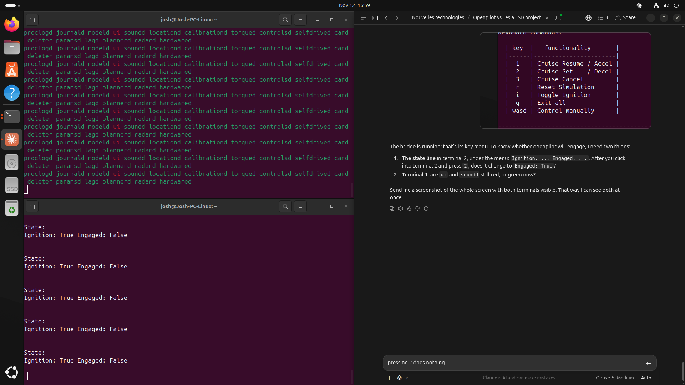
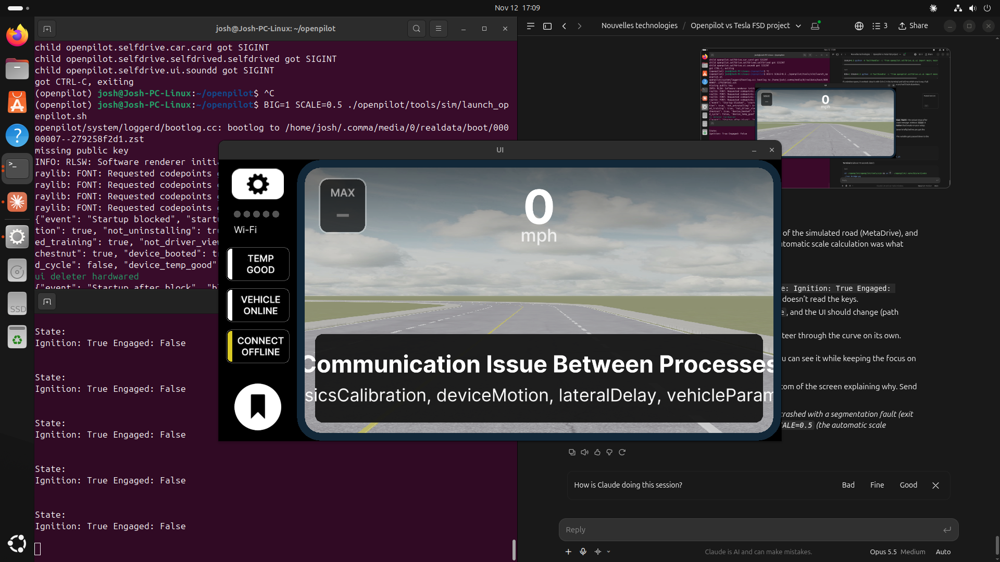
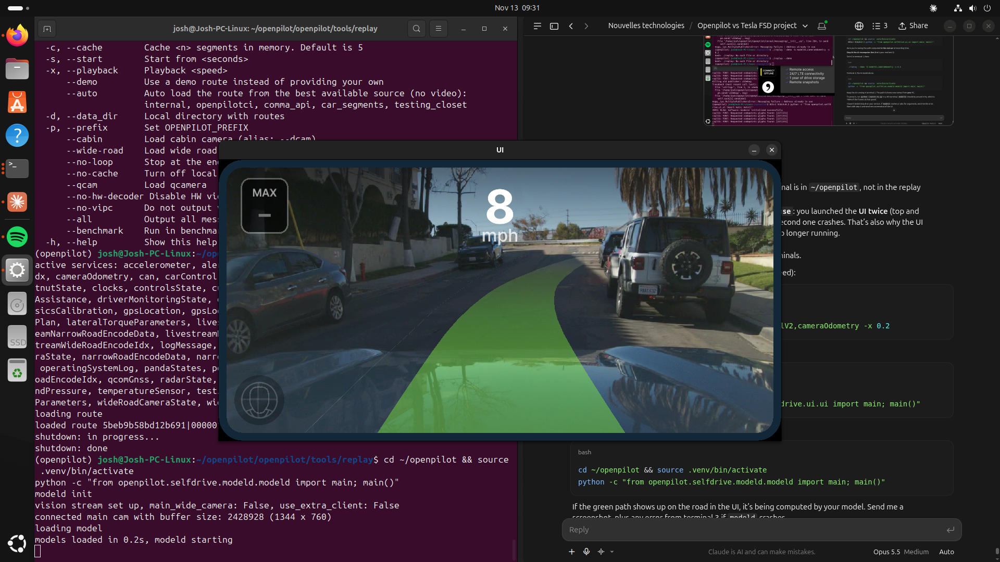
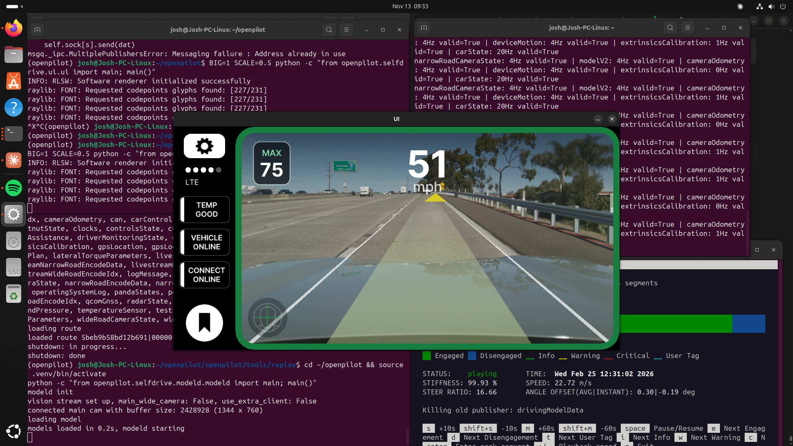

# Avancement — Projet 3 : openpilot vs Tesla FSD

**Joshua Leclerc** · 2026-11-25 · [Dépôt GitHub](https://github.com/AncientArrow292/projet3-openpilot)

## En bref

- openpilot installé et fonctionnel sur PC (Ubuntu 24.04, RTX 3070).
- Sur un vrai trajet enregistré, l'IA détecte correctement la route.
- En simulation temps réel, openpilot refuse de s'engager : le processeur est trop lent pour le modèle. Échec **sécuritaire**.
- Tests faits, rapport rédigé. Reste : démonstration et remise finale.

## État des étapes

| Étape | État |
|-------|------|
| Proposition et dépôt GitHub (cours 11) | ✅ Remis |
| Environnement d'essai : Ubuntu 24.04 en dual-boot, openpilot compilé, simulateur MetaDrive | ✅ Fonctionnel |
| Veille (versions d'openpilot suivies par RSS) | ✅ Trace dans `journal.md` |
| Tests : usage normal, cas d'échec, ressources | ✅ Faits, preuves dans `preuves/` |
| Comparaison avec Tesla FSD et recommandation | ✅ Dans `rapport.md` |
| Vidéos de secours pour la démo | ✅ Enregistrées |
| Démonstration et entrevue (cours 14) | ⏳ À préparer |
| Remise finale, tag `projet3-final` (cours 15) | ⏳ À faire |

## 1. Mise en place de l'environnement

Obstacles rencontrés et corrections :

| Obstacle | Correction |
|----------|-----------|
| Script d'installation officiel en échec | Installation manuelle |
| Simulateur MetaDrive désactivé dans les dépendances | Installé à la main |
| Interface qui plante au démarrage (segmentation fault) | Taille de fenêtre forcée : `BIG=1 SCALE=0.5` |

**Avant :** `ui` en rouge (plante), openpilot reste à `Engaged: False`.

**Après :** l'interface s'ouvre dans le simulateur.

## 2. Cas d'échec : openpilot refuse de s'engager en simulation

| Mesure | Obtenu | Attendu |
|--------|--------|---------|
| Images envoyées par le simulateur | ~16 / s | 20 / s |
| Images traitées par l'IA (`modelV2`) | **3-4 / s** | 20 / s |

Données trop lentes → jugées invalides → openpilot refuse de conduire plutôt que de mal conduire.

## 3. Ressources

- Modèle d'IA (`modeld`) : **100 % d'un seul cœur** du processeur.
- Carte graphique : 16 %, utilisée seulement par le simulateur.
- Essai du modèle sur la carte graphique (OpenCL) : résultats **faux à 100 %**, retour au processeur.

## 4. Usage normal : l'IA sur un vrai trajet

Rejeu d'un vrai trajet enregistré par comma, ralenti à 0,2×. Résultats d'IA enregistrés bloqués : **le PC recalcule tout**. Environ 97 % des images traitées.

**Courbe en ville :** la trajectoire suit la route.

**Autoroute :** lignes, trajectoire et véhicule devant (chevron jaune) détectés. Mesures de fréquence à droite.

**Arrêt :** véhicule devant proche détecté (chevron rouge).

- Aucune erreur visible sur ce trajet.
- **Limite :** une seule route, de jour, temps clair. Nuit, pluie et neige non testées.

## 5. Recommandation

**Adoption sous conditions, en projet pilote.**

| Pour | Contre |
|------|--------|
| Bonne perception de la route | Conduite (direction, freinage) non testée |
| Comportement sécuritaire en cas de problème | Un PC ne suffit pas : il faut l'appareil comma |
| Beaucoup moins cher que remplacer une flotte par des Tesla avec FSD | Branche de développement (`master`) testée, pas une version publiée |

Détails : [`rapport.md`](rapport.md).

## Changement par rapport à la proposition

- **Prévu :** maintien de voie et reprise de contrôle en simulation.
- **Fait à la place :** rejeu d'un vrai trajet, puisqu'openpilot refuse de s'engager sur ce PC.
- **À faire approuver.**

## Prochaines étapes

1. Faire approuver le changement de tests.
2. Préparer la démonstration du cours 14 : rejeu en direct, avec les vidéos de secours dans `preuves/`.
3. Corriger le rapport selon les commentaires reçus, puis créer le tag `projet3-final`.
