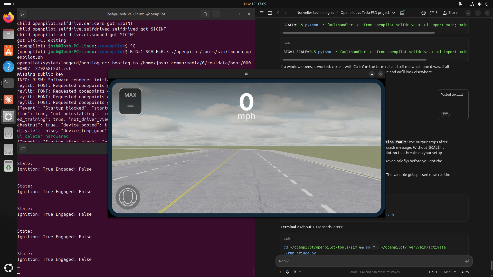
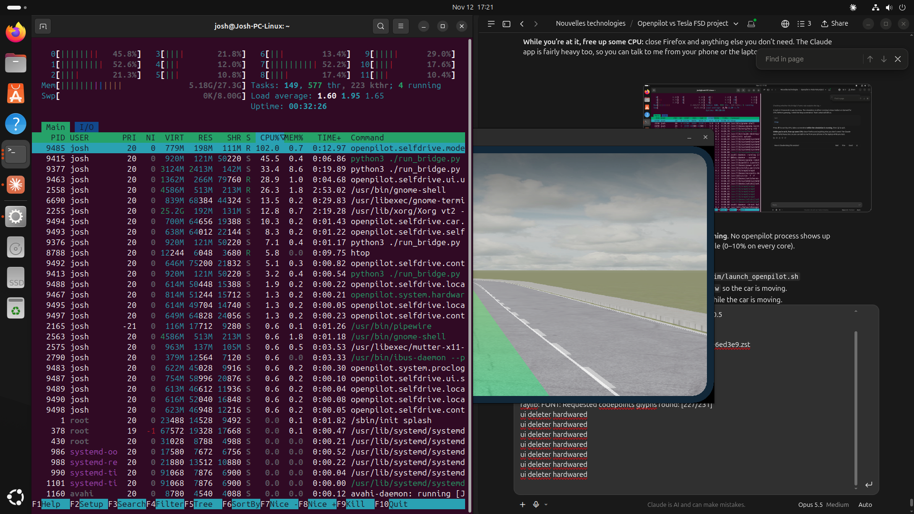
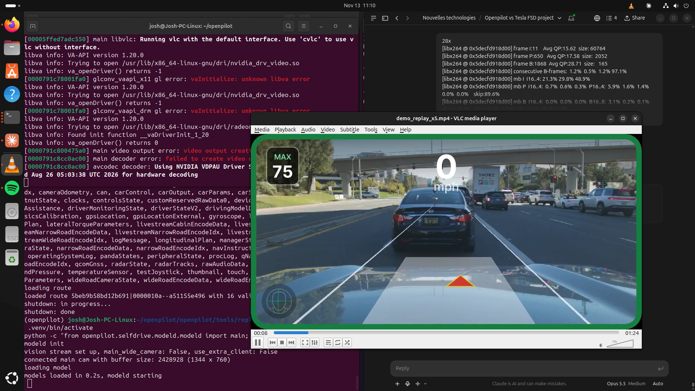

# Rapport d'avancement — Projet 3 : openpilot vs Tesla FSD

**Auteur :** Joshua Leclerc · **Date :** 2026-11-25
**Dépôt :** https://github.com/AncientArrow292/projet3-openpilot

## En bref

openpilot est installé et fonctionne sur mon PC (Ubuntu 24.04, RTX 3070). L'IA d'openpilot détecte correctement la route quand on lui fait analyser un vrai trajet enregistré. En simulation en temps réel, par contre, openpilot refuse de s'engager parce que mon processeur est trop lent pour le modèle. Il échoue de façon sécuritaire. Les tests sont faits, le rapport est rédigé, il reste à préparer la démonstration.

## Où j'en suis

| Étape | État |
|-------|------|
| Proposition et dépôt GitHub (cours 11) | ✅ Remis |
| Environnement d'essai : Ubuntu 24.04 en dual-boot, openpilot compilé, simulateur MetaDrive | ✅ Fonctionnel |
| Veille (versions d'openpilot suivies par RSS) | ✅ Trace dans `journal.md` |
| Tests : usage normal, cas d'échec, ressources | ✅ Faits, preuves dans `preuves/` |
| Comparaison avec Tesla FSD et recommandation | ✅ Rédigées dans `rapport.md` |
| Vidéos de secours pour la démo | ✅ Enregistrées |
| Démonstration et entrevue (cours 14) | ⏳ À préparer |
| Remise finale, tag `projet3-final` (cours 15) | ⏳ À faire |

## 1. Mise en place de l'environnement

openpilot ne s'est pas installé du premier coup. Voici les principaux obstacles :

- le script d'installation officiel plantait : j'ai fait l'installation à la main ;
- le simulateur MetaDrive était désactivé dans les dépendances : je l'ai installé à la main ;
- l'interface plantait au démarrage (segmentation fault) : réglé en forçant la taille de la fenêtre (`BIG=1 SCALE=0.5`).

Avant la correction, l'interface (`ui`) apparaît en rouge et openpilot reste à `Engaged: False` :

Après la correction, l'interface s'ouvre dans le simulateur :

## 2. Test d'échec : openpilot refuse de s'engager en simulation

Quand j'essaie d'engager openpilot, il affiche « Communication Issue Between Processes » et refuse de conduire.

**Pourquoi :** le simulateur envoie environ 16 images par seconde, mais le modèle d'IA n'en traite que 3 ou 4 (il en faudrait 20). Les données arrivent trop lentement, donc openpilot les juge invalides et refuse de s'engager. C'est le comportement voulu pour un système de sécurité : il préfère ne pas conduire plutôt que de mal conduire.

## 3. Test des ressources

Le modèle d'IA (`modeld`) utilise 100 % d'un seul cœur du processeur. La carte graphique n'est utilisée qu'à 16 %, seulement par le simulateur.

J'ai essayé de faire tourner le modèle sur la carte graphique (OpenCL), mais les résultats étaient faux à 100 %. Je suis revenu au processeur.

## 4. Test d'usage normal : l'IA sur un vrai trajet

Pour contourner la limite de vitesse, j'ai utilisé le rejeu d'un vrai trajet enregistré par comma, ralenti à 0,2×. J'ai bloqué les résultats d'IA enregistrés dans la voiture : c'est **mon PC** qui recalcule tout. Le modèle traite alors environ 97 % des images.

L'IA suit une courbe en ville :

Sur l'autoroute, elle détecte les lignes, la trajectoire et le véhicule devant (chevron jaune). On voit aussi les mesures de fréquence à droite :

À l'arrêt, elle détecte le véhicule devant, qui est proche (chevron rouge) :

Je n'ai trouvé aucune erreur visible sur ce trajet. **Limite :** c'est une seule route, de jour, par temps clair. Ça ne prouve rien pour la nuit, la pluie ou la neige.

## 5. Recommandation (version courte)

**Adoption sous conditions, en projet pilote.** L'IA d'openpilot donne une bonne perception et se comporte de façon sécuritaire. Elle coûte aussi beaucoup moins cher que de remplacer une flotte par des Tesla avec FSD. Mais :

- la conduite elle-même (direction, freinage) n'a pas pu être testée ;
- un PC ne suffit pas pour la valider : il faut l'appareil comma ;
- j'ai testé la branche de développement (`master`), pas une version publiée.

Les détails sont dans [`rapport.md`](rapport.md).

## Changement par rapport à la proposition

Les tests de maintien de voie et de reprise de contrôle en simulation n'ont pas pu être faits, puisqu'openpilot refuse de s'engager sur mon PC. Je les ai remplacés par le rejeu d'un vrai trajet. **Je dois faire approuver ce changement.**

## Prochaines étapes

1. Faire approuver le changement de tests.
2. Préparer la démonstration du cours 14 : rejeu en direct, avec les vidéos de secours dans `preuves/`.
3. Corriger le rapport selon vos commentaires, puis créer le tag `projet3-final`.
